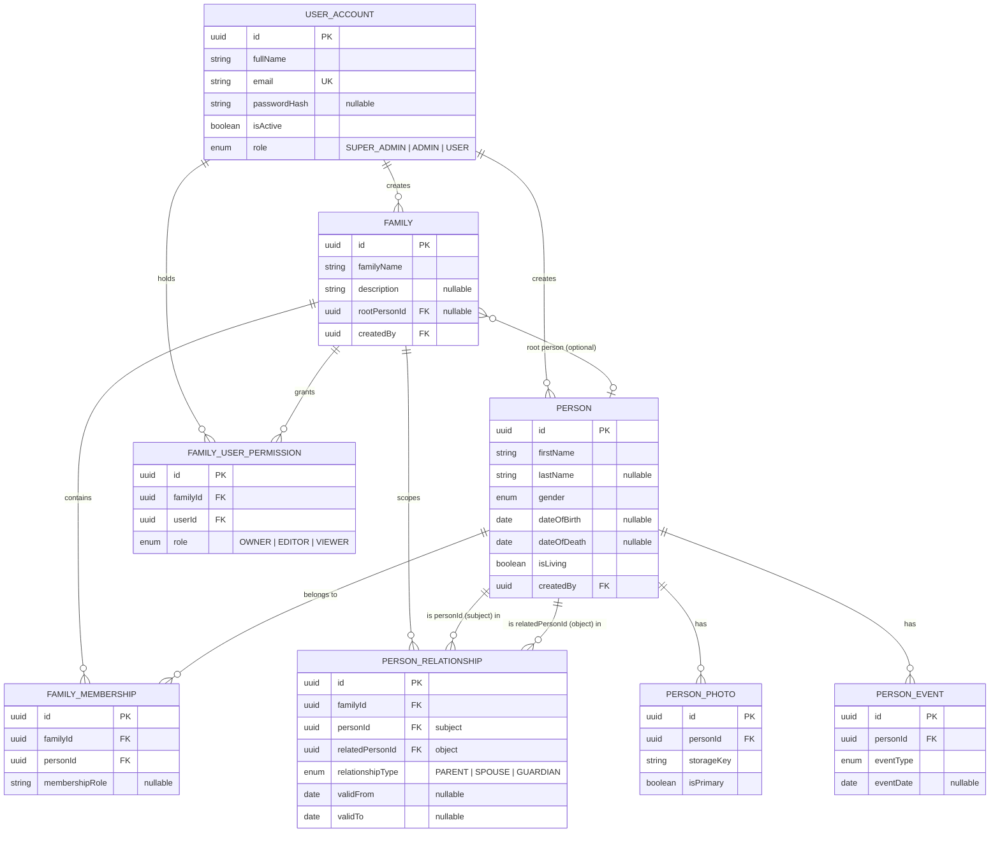

# Family Tree Management System

A full-stack application for recording multigenerational family history: people,
relationships (parents, spouses, guardians), life events, photos, and an
interactive family tree - with per-family access control.

This is a monorepo with two independently deployable apps:

```
family_tree/
  frontend/   Angular app (UI)
  backend/    Node.js + Express REST API (Prisma + PostgreSQL)
  docker-compose.yml   PostgreSQL for local development
```

Status: **Phase 1 complete** (architecture, database schema, migrations, seed
data). See [Implementation phases](#implementation-phases) below for what's
built and what's next.

## 1. Architecture overview

- **Frontend**: Angular (standalone components, lazy-loaded feature routes,
  Angular Material, Reactive Forms) talks to the backend only through typed
  API services - no direct database or storage access.
- **Backend**: Express REST API. Each feature module (`auth`, `families`,
  `persons`, `relationships`, `photos`, `events`, `permissions`) is split into
  routes -> controllers -> services, with Zod schemas validating every
  request. Controllers stay thin; business rules and transactions live in
  services.
- **Database**: PostgreSQL, accessed through Prisma. All primary keys are
  UUIDs. Prisma's query API handles ordinary CRUD; ancestor/descendant tree
  traversal uses a hand-written, parameterized `WITH RECURSIVE` SQL query
  (via `prisma.$queryRaw` with tagged-template parameters, never string
  concatenation) because Prisma cannot express recursive queries natively.
- **Auth**: JWT access/refresh tokens (bcrypt-hashed passwords). The Angular
  route guard is a UX convenience only, never the real security boundary -
  every mutating endpoint re-checks on the server.
- **Authorization is split into two different scopes** - see "Open
  collaboration model" below for why persons/relationships are open while
  families stay permission-gated.
- **File storage**: a small storage abstraction (`StorageProvider` interface)
  with a local-disk implementation for development and an S3-compatible
  implementation for production, selected by `STORAGE_DRIVER`. Only
  `storageKey` + metadata are persisted in Postgres; binaries never go in an
  ordinary table row.
- **One relationship table, not one per type**: `person_relationships` is a
  single directed-edge table (`relationshipType` enum: `PARENT`, `SPOUSE`,
  `GUARDIAN`). Siblings are derived at query time from shared `PARENT` edges
  rather than stored. A "former spouse" is a `SPOUSE` row with `validTo` set
  - no extra table or flag needed. See the schema comments in
  [`backend/prisma/schema.prisma`](backend/prisma/schema.prisma) for the full
  reasoning, including how adoption/step-parent types will be added later.

### Open collaboration model

Two different authorization philosophies are deliberately in effect, by
explicit user request (moving away from the stricter design Phase 1/2
started with):

- **Families** stay permission-gated: `GET /api/families` only lists
  families you have a `FamilyUserPermission` row for, and only an
  `OWNER`/`EDITOR` can rename/delete one. A family is still "your" private
  workspace for discovery purposes.
- **Persons and relationships are open to every authenticated account**,
  regardless of `UserRole` or `FamilyUserPermission`:
  - Any logged-in user can add a person to **any** family (not just ones
    they have a permission row for), and can view/edit/delete **any**
    person in the system.
  - Any logged-in user can create a relationship between **any two
    people**, regardless of which family(ies) either belongs to. Relating
    two people under a given family's context auto-adds both as members of
    that family if they weren't already (`ensureBothAreMembers` in
    `relationships.service.ts`) rather than rejecting the request - so a
    family's tree view stays a complete, connected picture instead of
    silently missing an edge to someone recorded elsewhere.
  - `GET /api/persons` (no family scoping) lists every person in the
    system, used by the frontend's relation picker so it can suggest anyone,
    not just people already in the family you're viewing.
  - Data-integrity rules still apply regardless of who's calling: no parent/
    child cycles, no duplicate edges, `SPOUSE` pairs are still canonicalized.
    These aren't authorization - they protect the graph from becoming
    nonsensical, which matters even more with no permission gate to slow
    anyone down.

Practical implication: a brand-new self-registered `USER` account can
immediately edit anyone's family data. That's intentional for this
application, not an oversight - treat it as a trust assumption worth
revisiting if this ever needs per-family privacy.

### Why Prisma 7's connection setup looks different

Prisma 7 removed the `url` field from `datasource` in `schema.prisma`.
Connection info now lives in two places:

- [`backend/prisma.config.ts`](backend/prisma.config.ts) - read by the
  **Prisma CLI** (`migrate`, `studio`, `db pull`) only.
- [`backend/src/config/prisma.ts`](backend/src/config/prisma.ts) - the
  **app's own `PrismaClient`**, constructed with an explicit `@prisma/adapter-pg`
  driver adapter (required by Prisma 7 at runtime). Import `prisma` from this
  module everywhere in backend code instead of constructing a new client.

## 2. Technology stack (versions pinned and verified compatible)

| Layer | Choice | Version |
|---|---|---|
| Frontend framework | Angular (standalone components) | 22.2.x |
| Frontend UI | Angular Material + CDK | 22.2.2 |
| Frontend language | TypeScript | ~6.0.3 |
| Frontend test runner | Vitest | ^5.0.0 (Angular CLI default) |
| Backend runtime | Node.js | >=24.0.0 (developed on 24.21.0) |
| Backend language | TypeScript | 6.0.3 |
| Backend framework | Express | 5.3.0 |
| ORM | Prisma / @prisma/client | 7.10.0 |
| Postgres driver adapter | @prisma/adapter-pg + pg | 7.10.0 / 8.23.1 |
| Validation | Zod | 4.6.5 |
| Auth | jsonwebtoken + bcrypt | 9.0.3 / 6.0.0 |
| Logging | pino + pino-http | 10.4.0 / 11.0.0 |
| Security middleware | helmet, cors, express-rate-limit | 8.3.0 / 2.8.6 / 8.7.1 |
| Uploads / images | multer + sharp | 2.4.0 / 0.35.5 |
| Backend tests | vitest + supertest | 5.0.3 / 7.3.1 |
| Database | PostgreSQL (Docker) | 18-alpine |
| DB admin client | DBeaver | any recent version (external desktop app) |

All exact versions are pinned (no `^`/`~` ranges) in
[`backend/package.json`](backend/package.json) so installs are reproducible.

**Note on `prisma` CLI's own dependency tree**: `npm audit` reports 4 high
severity advisories (`deepmerge-ts`, `mysql2`) that come from the `prisma`
CLI's internal multi-database tooling, not from `@prisma/client` or any
runtime code path. `prisma` is a devDependency; `npm audit fix --force` would
downgrade it to an older major (6.19.3), which we deliberately avoided. Treat
this as a known, low-risk, dev-tool-only advisory - re-check it when
upgrading Prisma.

## 3. Entity-relationship diagram



### Relationship and cardinality notes

- **UserAccount 1 -> N Family / Person (`createdBy`)**: every family and
  person record tracks its creator. `onDelete: Restrict` - a user cannot be
  hard-deleted while they still own records (deactivate via `isActive`
  instead).
- **Family 1 -> N FamilyMembership <- N 1 Person** (many-to-many through
  `FamilyMembership`): a person can belong to multiple family trees; a family
  has many members. Unique on `(familyId, personId)`.
- **Family 0..1 -> 1 Person (`rootPersonId`)**: optional "anchor" person a
  tree is drawn from. `onDelete: SetNull` - deleting that person doesn't
  delete the family, just clears the pointer.
- **Family 1 -> N PersonRelationship**: every relationship edge is scoped to
  one family tree (the same two people could have a different-looking
  relationship recorded in a different tree, e.g. adoptive vs. biological
  trees).
- **Person 1 -> N PersonRelationship (twice)**: a person can appear as the
  *subject* (`personId`) of many edges and as the *object*
  (`relatedPersonId`) of many others. Two distinct Prisma relation names
  (`RelationshipAsPerson` / `RelationshipAsRelatedPerson`) because both FKs
  point at the same `Person` table.
- **Person 1 -> N PersonPhoto, Person 1 -> N PersonEvent**: standard
  one-to-many, cascade-deleted with the person.
- **Family 1 -> N FamilyUserPermission <- N 1 UserAccount**: per-family
  access control, unique on `(familyId, userId)`.

Constraints that aren't expressible in the Prisma schema language are added
by hand in
[`backend/prisma/migrations/20261011120100_add_check_constraints/migration.sql`](backend/prisma/migrations/20261011120100_add_check_constraints/migration.sql):

- A person's death date can't precede their birth date.
- A living person can't have a death date.
- A relationship row can't point a person at themselves.
- `validTo` can't precede `validFrom`.
- **Spouse de-duplication**: `SPOUSE` rows must have `personId < relatedPersonId`
  (UUIDs compared lexically) - enforced by both the relationship service
  (Phase 2) and this DB CHECK constraint, so "A married to B" can never be
  stored as two different rows.
- **One primary photo per person**: a partial unique index on
  `person_photos(person_id) WHERE is_primary = true`.

Two invariants are **not** DB constraints because they require graph
traversal, not a row-local check - they belong in the Phase 2 relationship
service, inside a transaction:
- Preventing parent/child cycles (nobody can be their own ancestor).
- Verifying both people in a relationship belong to the stated family.

### System roles vs. family roles

There are **two independent authorization axes** - don't conflate them:

| | `UserRole` (`user_accounts.role`) | `PermissionRole` (`family_user_permissions.role`) |
|---|---|---|
| Scope | Global, one per account | Per family tree, one row per (family, user) |
| Question it answers | "Can this account administer other *accounts*?" | "Can this account edit *this specific family tree*?" |
| Values | `SUPER_ADMIN`, `ADMIN`, `USER` | `OWNER`, `EDITOR`, `VIEWER` |

`UserRole` permission matrix (enforced server-side in the Phase 2 `users`
module, not just hidden in the UI):

| Caller role | Can create | Can view |
|---|---|---|
| `SUPER_ADMIN` | `ADMIN`, `USER` accounts | all accounts |
| `ADMIN` | `USER` accounts only | `USER` accounts only |
| `USER` | nothing (403) | other `USER` accounts only |

Notes:
- **No API endpoint ever creates a `SUPER_ADMIN`** - not even another
  `SUPER_ADMIN` can do it through the API. The first (and any further)
  super-admin is provisioned via the seed script or direct database access.
  This is deliberate: it removes privilege escalation to the top role as an
  API attack surface entirely.
- Public self-registration (`POST /api/auth/register`) always creates a
  `USER`-role account. `ADMIN`/`SUPER_ADMIN` accounts are only ever
  provisioned by an existing admin through the protected `users` endpoints.
- Holding `ADMIN` or `SUPER_ADMIN` grants **no** implicit access to any
  family's data. Seeing someone's family tree still always goes through
  `FamilyUserPermission` - the two systems never short-circuit each other.

## 4. Project folder structure

```
family_tree/
  docker-compose.yml          PostgreSQL for local dev
  .gitignore
  README.md                   This file

  frontend/                   Angular app
    src/app/
      core/                   auth, guards, interceptors, services (Phase 3)
      shared/                 components, pipes, validators (Phase 3)
      features/
        dashboard/
        families/
        persons/
        relationships/
        family-tree/
        photos/
        events/
        permissions/
        settings/

  backend/                    Express REST API
    prisma/
      schema.prisma            Data model (source of truth)
      migrations/               Versioned, committed SQL migrations
      seed.ts                   Sample 3-generation family
    prisma.config.ts            Prisma CLI config (Prisma 7)
    src/
      config/                   env/config loading, Prisma client (adapter-based)
      middleware/                auth, error handling, rate limiting (Phase 2)
      modules/
        auth/
        families/
        persons/
        relationships/
        photos/
        events/
        permissions/
      common/
        errors/
        validators/
        utils/
      app.ts, server.ts         Phase 2
    tests/                      Phase 2+
    uploads/                    Local file storage (dev only, gitignored contents)
    .env.example
    .env                        Local dev secrets (gitignored, generated for you)
```

Folders for Phase 2+ code already exist (with `.gitkeep`) so the structure is
confirmed up front, per the project's phased build plan.

## 5. Prerequisites

- Node.js >= 24 and npm (already verified in this environment: Node 24.21.0,
  npm 11.19.0).
- **Docker Desktop** (for PostgreSQL via `docker-compose.yml`). **Not
  installed in this environment** - install it to run the database steps
  below, or point `DATABASE_URL` at any PostgreSQL 14+ instance you already
  have.
- [DBeaver](https://dbeaver.io/) (optional, for browsing/querying the
  database with a GUI).

## 6. Environment configuration

```bash
cd backend
cp .env.example .env   # a working .env with generated secrets already exists; .env.example documents it
```

Key variables (see `.env.example` for the full list and comments):

| Variable | Purpose |
|---|---|
| `DATABASE_URL` | Postgres connection string, matches `docker-compose.yml` defaults |
| `JWT_ACCESS_SECRET` / `JWT_REFRESH_SECRET` | Token signing secrets (generate your own for anything beyond local dev) |
| `CORS_ORIGIN` | Allowed frontend origin (`http://localhost:4200`) |
| `STORAGE_DRIVER` | `local` (dev) or `s3` (production) |
| `RATE_LIMIT_*` | Rate limiting thresholds |

Never commit a real `.env`. The repo's `.gitignore` already excludes it; only
`.env.example` is tracked.

## 7. Database setup (Docker Compose)

```bash
# from the repo root
docker compose up -d
docker compose ps        # wait for postgres to report "healthy"
```

This starts PostgreSQL 18 on `localhost:5432` with:
- database: `family_tree_db`
- user: `family_tree_app`
- password: `changeme` (dev only - matches `backend/.env`)

## 8. Prisma migrations

The migration history already exists and is committed:

```
backend/prisma/migrations/
  migration_lock.toml
  20261011120000_init/migration.sql                 generated schema (tables, enums, FKs, indexes)
  20261011120100_add_check_constraints/migration.sql  CHECK constraints + partial unique index
  20261011130000_add_user_role/migration.sql          UserRole enum + user_accounts.role column
```

**How `20261011120000_init` was produced**: this sandbox has no Docker/Postgres
available, so instead of `prisma migrate dev` (which needs a live database),
the SQL was generated offline and deterministically from the schema with:

```bash
cd backend
npx prisma migrate diff --from-empty --to-schema=prisma/schema.prisma --script
```

This has **not yet been executed against a real database** - only validated
with `prisma validate` and reviewed by hand against the schema. Once Docker
(or any reachable Postgres) is available, apply it with:

```bash
cd backend
npx prisma migrate deploy      # applies both migrations in order
# or, if you plan to keep evolving the schema interactively:
npx prisma migrate dev
```

`prisma migrate dev` will detect the existing migration folders and apply
them, then keep the schema and migration history in sync for any further
changes you make to `schema.prisma`.

Generate the Prisma client any time after changing the schema:

```bash
npm run prisma:generate
```

## 9. Seeding sample data

```bash
cd backend
npm run db:seed
```

Creates three demo accounts (one per `UserRole`), one family ("The Reddy
Family"), and 10 people across three generations - including a divorced
"former spouse" example and siblings derived from shared parents - so the
relationship model, the role hierarchy, the future tree view, and API work
all have realistic data immediately.

All demo accounts use password `Passw0rd!2026` (local dev only):

| Email | `UserRole` | Notes |
|---|---|---|
| `demo.owner@familytree.local` | `SUPER_ADMIN` | Also owns the seeded family (`PermissionRole.OWNER`) |
| `demo.admin@familytree.local` | `ADMIN` | Can create/view `USER` accounts |
| `demo.user@familytree.local` | `USER` | Can view other `USER` accounts only |

`prisma migrate reset` (drops the DB, reapplies all migrations, then seeds
automatically) is the fastest way to get back to a clean state:

```bash
npm run prisma:migrate:reset
```

## 10. DBeaver connection

1. **Database > New Database Connection > PostgreSQL**.
2. Host: `localhost`, Port: `5432`, Database: `family_tree_db`.
3. Username: `family_tree_app`, Password: `changeme`.
4. Test Connection -> Finish.
5. DBeaver is a client only; it talks to the same Postgres container the
   backend uses. No separate setup is needed on the database side.

## 11. Running the apps

```bash
# Backend
cd backend
npm install
npm run dev     # http://localhost:3000 - fails fast if it can't reach Postgres

# Frontend (separate terminal)
cd frontend
npm install
npm start       # http://localhost:4200
```

Confirm the backend is up and talking to the database:
```bash
curl http://localhost:3000/api/health/db
```

### Frontend: what's built so far

- **Login** (`/login`): email + password only - no role selector. The
  account's role isn't something you pick at login; it's intrinsic to the
  account and comes back from the backend.
- **Dashboard** (`/dashboard`, behind `authGuard`): lists the families you
  have a permission row for as selectable chips (when you have more than
  one), with a "New family" dialog (`POST /api/families`) and a logout
  button. Selecting a family renders `<app-family-tree-view>` below it.
- **Family tree view** (`family-tree-view/`): a genealogical node-link
  diagram, not a list - replaces an earlier `mat-tree` indented-list version
  entirely. Built in three parts:
  - `tree-layout.ts` - a pure, dependency-free layout function (no D3 or
    other charting library pulled in). Computes each person's generation by
    walking `PARENT` edges, then a correction pass that raises anyone who
    married in (no recorded parents) to their spouse's generation instead of
    defaulting them to generation 0 - this was a real bug caught by eyeballing
    the live render (spouses were floating at the top regardless of which
    generation they'd actually married into) and fixed by re-ordering when
    spouse-equalization runs relative to parent-chain propagation.
  - The component renders that layout as inline SVG: circular nodes
    (initials, name, lifespan), colored by generation, connected by cubic-
    bezier curves for `PARENT`/`GUARDIAN` edges and a straight gold line for
    `SPOUSE` edges, on a gradient background - styled after a reference
    image the user provided mid-session (radial node-link diagram, not an
    indented tree list).
  - Click a node for a menu: **Edit details** or **Add relation**. A
    toolbar has **Add person** and +/- zoom controls.
  - Fetches `GET /api/families/:id/tree` (nodes + edges in one call, per the
    backend's "no N+1 per person" design) and recomputes the whole layout
    client-side whenever the tree changes.
- **Add/Edit person dialogs**: collect the full `Person` shape - first/
  middle/last name, surname, gender, date of birth (+ "approximate" flag),
  date of death, place of birth, current city, occupation, description.
  Edit pre-fills from the clicked node and calls `PUT /api/persons/:id`.
  Add also has an optional "relate to someone" section (parent of / child
  of / spouse of / guardian of / ward of), searched from **every family**
  via `GET /api/persons` (not just the current one) - matching the backend's
  open collaboration model. Photo upload is intentionally **not** included -
  no storage/upload endpoint exists on the backend (Phase 5).
- **Add Relation dialog**: the same relation picker as a standalone action
  (anchored at whichever person's node you clicked), for relating two
  people who already exist - `POST .../relationships` via
  `RelationshipsApiService`.
- **Auth plumbing** (`core/auth/`): the access token lives in memory only
  (never `localStorage`); the refresh token is the backend's httpOnly
  cookie. An `HttpInterceptorFn` attaches the access token to every request
  and retries once via `/api/auth/refresh` on a 401. A
  `provideAppInitializer` silently re-authenticates from the refresh cookie
  before the app's first render, so a page reload doesn't bounce an
  authenticated user back to `/login`.
- Not built yet: a member directory (searchable flat list, as opposed to the
  tree view), photos, events, permissions UI, settings, and a "Manage
  Users" screen for the `UserRole` admin endpoints (`POST`/`GET
  /api/users`) - those still only exist at the API level.

### API available so far

| Method & path | Auth | Notes |
|---|---|---|
| `POST /api/auth/register` | public | Always creates a `USER`-role account |
| `POST /api/auth/login` | public | Returns an access token + sets an httpOnly refresh cookie |
| `POST /api/auth/refresh` | refresh cookie | Issues a new access token |
| `POST /api/auth/logout` | - | Clears the refresh cookie (see note on stateless JWTs below) |
| `GET /api/users/me` | any authenticated role | Caller's own profile |
| `GET /api/users` | any authenticated role | Scoped per the `UserRole` matrix; supports `page`, `pageSize`, `search` |
| `GET /api/users/:id` | any authenticated role | 404 if the target is outside the caller's visibility scope |
| `POST /api/users` | `ADMIN`, `SUPER_ADMIN` | Creates an `ADMIN` or `USER` account (never `SUPER_ADMIN` - rejected by validation) |
| `POST /api/families` | any authenticated role | Caller becomes `OWNER` of the new family |
| `GET /api/families` | any authenticated role | Only families the caller has a `FamilyUserPermission` row for - `UserRole` grants no implicit access. Each family includes `callerRole` so the frontend knows whether to show edit actions without a second lookup |
| `GET /api/families/:familyId` | `VIEWER`+ on that family | 404 (not 403) if the caller has no permission row - avoids confirming the family exists |
| `PUT /api/families/:familyId` | `EDITOR`+ | `rootPersonId` must already be a member of the family |
| `DELETE /api/families/:familyId` | `OWNER` only | Cascades memberships/relationships/permissions; does not delete the Person records themselves |
| `POST /api/families/:familyId/persons` | any authenticated user | Creates the person and adds them to this family in one transaction - no permission row needed on the family (see "Open collaboration model") |
| `GET /api/families/:familyId/persons` | any authenticated user | Supports `page`, `pageSize`, `search`, `gender`, `isLiving`, `birthYearFrom`/`birthYearTo`, `sortBy`/`sortOrder` |
| `GET /api/persons` | any authenticated user | **Global** list across every family - no familyId. Powers the frontend's relation picker |
| `GET /api/persons/:id` | any authenticated user | Not family-scoped - a person can belong to multiple families |
| `PUT /api/persons/:id` | any authenticated user | |
| `DELETE /api/persons/:id` | any authenticated user | Permanently deletes the person from **every** family they belong to - no family-scoped "remove membership" endpoint yet |

| Method & path | Auth | Notes |
|---|---|---|
| `POST /api/families/:familyId/relationships` | any authenticated user | The two people need not already be members of this family - creating the edge auto-adds both as members instead of rejecting. Prevents parent/child cycles, canonicalizes `SPOUSE` pairs |
| `GET /api/families/:familyId/relationships` | any authenticated user | All edges in the family (no pagination - counts are small by nature) |
| `PUT /api/relationships/:relationshipId` | any authenticated user | Only `validFrom`/`validTo`/`notes` are editable - redefining who/what a relationship connects means delete + recreate, not a PUT |
| `DELETE /api/relationships/:relationshipId` | any authenticated user | |
| `GET /api/families/:familyId/tree` | any authenticated user | Every member person (nodes) + every relationship edge in **one** call - not one request per person |
| `GET /api/families/:familyId/ancestors/:personId` | any authenticated user | Recursive `WITH RECURSIVE` CTE over `PARENT` edges; each result includes `depth` (1 = parent, 2 = grandparent, ...) |
| `GET /api/families/:familyId/descendants/:personId` | any authenticated user | Same, walking the other direction |

**Relationship business rules** (`relationships.service.ts` + `common/db/ancestry.ts`) -
data integrity, not authorization (see "Open collaboration model" above):
- `SPOUSE` is symmetric: always stored with `personId < relatedPersonId` (UUIDs compared lexically), computed server-side regardless of the order submitted - so "A married to B" can never be stored as two separate rows. The existing DB CHECK constraint from Phase 1 is the backstop if this logic is ever bypassed.
- Creating a `PARENT` edge is rejected (`400`) if it would make someone their own ancestor - checked via the same recursive ancestor query the `/ancestors` endpoint uses, run inside the same transaction as the insert. This check is scoped per-family (it walks `PARENT` edges tagged with the acting familyId), so a cycle spanning two different families' relationship sets wouldn't be caught - a known gap, not a deliberate design choice.
- Duplicate edges are rejected by the DB's unique constraint, surfaced as `409`.
- Siblings are **not** a stored relationship or a dedicated endpoint - derive them client-side from `/tree`'s edges (two people who share a `PARENT` edge from the same person are siblings), matching the schema's "don't store redundant sibling links" design from Phase 1.

Everything else (`photos`, `events`, family-level `permissions` CRUD) is
still unbuilt.

**Known limitation**: logout is stateless - it clears the refresh cookie but
can't revoke an already-issued access token server-side (no token/session
store exists). The short access-token TTL (`JWT_ACCESS_EXPIRES_IN`, default
15m) bounds the exposure window. A revocation list would be a reasonable
addition to the optional future tables if this becomes a real requirement.

## 12. Testing

```bash
cd backend
npm test
```

This runs `pretest` first (creates a separate `family_tree_test` database on
the same Postgres server if it doesn't exist, then applies all committed
migrations to it - so tests never touch dev/seed data), then runs
`vitest run`. Current coverage: registration/login/refresh/401 handling
(`tests/auth.test.ts`), the full `UserRole` permission matrix (`tests/users.test.ts`),
and relationship business rules - cycle prevention, `SPOUSE` canonicalization,
cross-family membership validation, and the `/tree` graph endpoint
(`tests/relationships.test.ts`). `families`/`persons` themselves are still a
gap - manually verified end-to-end, no automated suite yet.

Frontend: `npm test` (vitest, Angular CLI default) - component/service tests
land in Phase 3.

## 13. Security considerations (so far)

- Passwords are bcrypt-hashed (cost factor 12) in both the seed script and
  the real `register`/`users.create` code paths; plaintext is never stored
  or logged (pino redacts `authorization`, `cookie`, and any `password`/
  `passwordHash` fields).
- Auth is JWT access (short-lived, returned in the response body) +
  JWT refresh (httpOnly, `sameSite: lax` cookie, scoped to `/api/auth`).
- Every protected route re-checks the caller's role server-side
  (`authenticate` + `requireRole` middleware) - never relying on a frontend
  route guard as the real boundary. The `UserRole` matrix (who can create/
  view which accounts) is enforced in `users.service.ts`, not just hidden in
  a UI, and is covered by `tests/users.test.ts`.
- No API path can ever create a `SUPER_ADMIN` account (enforced at both the
  Zod validation layer and the service layer) - closing off the top
  privilege level as an attack surface entirely.
- Secrets live in `.env`/`.env.test` (`.env` is gitignored; `.env.test` has
  no real secrets and is committed so tests run without setup).
- Helmet, CORS (restricted to `CORS_ORIGIN`), and rate limiting (general +
  a tighter limit on `/api/auth/register` and `/api/auth/login`) are active
  on every request.
- Family-scoped records (once Phase 2's remaining modules land) will be
  reachable only through `FamilyUserPermission` checks - UUIDs alone are
  never treated as a capability token.
- File uploads will be validated by content (via `sharp`), not by trusting
  the client-supplied extension (Phase 5).

This section expands with each phase (CORS, rate limiting, auth token
handling, upload validation, structured logging without secrets, data
export/deletion policy).

## 14. Troubleshooting

| Problem | Fix |
|---|---|
| `docker compose up` fails / `docker` not found | Install Docker Desktop and ensure it's running |
| `prisma migrate deploy` can't reach the database | Confirm `docker compose ps` shows postgres as healthy and `DATABASE_URL` in `backend/.env` matches |
| `npm install` blocks on install scripts | This repo's `backend/package.json` already has `allowScripts` entries for `bcrypt`, `prisma`, and `@prisma/engines`; run `npm rebuild` if native bindings didn't build |
| Prisma Client out of date after a schema change | `npm run prisma:generate` |

## Implementation phases

- [x] **Phase 1 - Architecture and database**: project structure, ER diagram,
      Prisma schema, Docker Compose, initial + constraints migrations, seed
      data, DBeaver instructions. *(this document)*
- [~] **Phase 2 - Backend** (in progress): Express app ✅, auth
      (register/login/refresh/logout) ✅, system `UserRole` administration
      (`users` module, enforced server-side, tested) ✅, `families` + `persons`
      CRUD with family-level `PermissionRole` enforcement ✅ (manually verified,
      no automated suite yet), `relationships` + family tree traversal
      (recursive ancestor/descendant CTEs, cycle prevention, `SPOUSE`
      canonicalization, tested) ✅. Authorization was later deliberately
      reworked to an "open collaboration model" (see above) by explicit
      request - persons/relationships are no longer `PermissionRole`-gated,
      only families are. Still missing: photos, events, family-level
      `permissions` CRUD endpoints.
- [~] **Phase 3 - Frontend** (started): Angular Material added, login screen
      ✅, auth plumbing (interceptor + silent refresh + route guard) ✅,
      add/edit person dialogs ✅, standalone add-relation dialog ✅. Still
      missing: family management (edit/delete), a member directory (flat
      searchable list, separate from the tree view), person profile detail
      view, API services for persons CRUD beyond listing.
- [~] **Phase 4 - Family tree** (started): a real node-link visualization
      exists (`family-tree-view/`) - generation-based layout, curved SVG
      connectors, colored-by-generation nodes, +/- zoom - built from
      `GET .../tree` and styled after a reference image. Still missing:
      pan (only scroll/zoom today), search-to-highlight, branch collapsing
      for large trees, and testing against deliberately complex/tangled
      structures (the layout algorithm's crossing-minimization is a simple
      DFS ordering, not optimized for heavily tangled graphs).
- [ ] **Phase 5 - Additional features**: photo upload/gallery (storage
      abstraction), life events UI, permissions UI, optional audit history.
- [ ] **Phase 6 - Finalization**: full test run, security review, performance
      pass, deployment docs.
